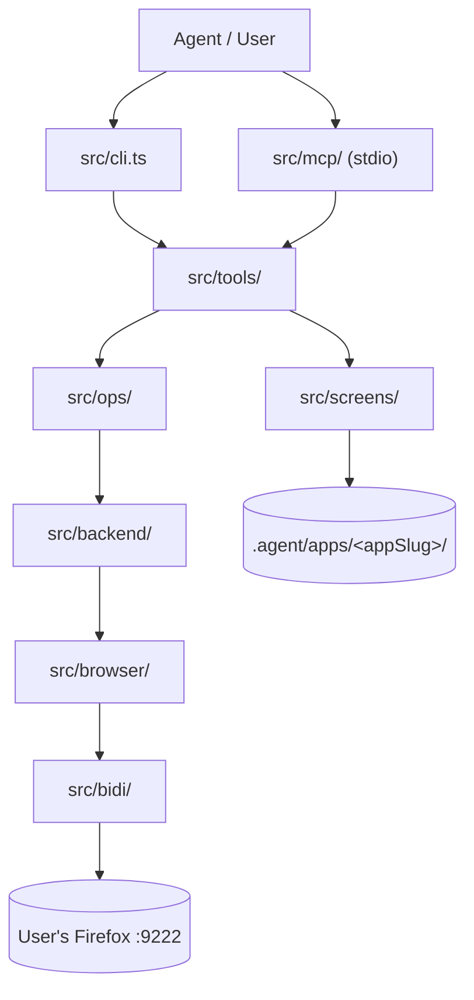

# Architecture Blueprint

This document defines the system architecture, directory boundaries, topology, and technical stack. AI agents must consult it before modifying system structure or introducing new components.

---

## 🏛️ System Overview & Boundaries

### 1. Overview

Local-only CLI + MCP adapter driving standalone Firefox PWA instances over W3C WebDriver BiDi. No production deploy in MVP. Datastore is the local filesystem (JSON); identity is the user's standalone Firefox profile under `.agent/apps/<appSlug>/profile`, where the user performs logins.

### 2. Tech Stack & Dependencies

| Decision | Choice | Why |
|---|---|---|
| Runtime | Node 22 LTS, ESM (`"type": "module"`, `moduleResolution: "nodenext"`), TypeScript strict, `target: es2024` | LTS + native TS support; pinned TypeScript 5.x accepts at most es2024 |
| Package manager | pnpm 11 | Fast, strict, requires Node 22 |
| Browser automation | Raw W3C WebDriver BiDi over WebSocket (Node 22 global `WebSocket`, zero runtime deps) attached to the runtime started with `--remote-debugging-port` | Standard protocol, reuses the logged-in profile; Playwright's patched Firefox cannot attach to the user's PWA |
| Snapshot contract | `{snapshotId, url, title, elements[{ref, role, name, value, disabled}]}` written to disk | Refs stable per snapshot only |
| Screen map | `.agent/apps/<appSlug>/screens.json`, validated by `schemas/screen-map.schema.json` (JSON Schema 2020-12, Ajv); routes as URL Pattern strings; flows and multi-screen journeys with `expectScreen` settle assertions | Known screens need no snapshot |
| Interface | CLI + MCP stdio adapter (`@modelcontextprotocol/sdk`) + `SKILL.md`, both delegating to `src/tools/` | CLI-first is token-efficient; MCP reuses the same backend |
| Write safety | Dry-run/armed modes, kill-switch file, origin allow-list, upload path boundary | Limits prompt-injection blast radius |
| Evidence | BiDi `captureScreenshot` saved to `.agent/screenshot.png` and `.agent/evidence/` | Context economy |
| Secrets | `.env`, never committed | Standard |

Declined: custom WebSocket bridge in MVP (reuse existing MCP servers); headless credential-based login (use the user's own session).

### 3. Layer Boundaries & Directory Map

| Layer | Directory | Responsibilities | Depends on |
|---|---|---|---|
| Core Domain | `src/core/` | Snapshot types, error taxonomy (`PwaNavError`, exit codes 2–15), security gates (allow-list, kill-switch, upload boundary), stable ref store | Zero external I/O |
| Screens | `src/screens/` | Screen map models, schema validation, route matching, compact view, learn & merge, journeys, semantic target resolution | `core` |
| BiDi Protocol | `src/bidi/` | WebSocket client, framing, protocol commands (`input.setFiles`, `browsingContext.captureScreenshot`), session lifecycle, fake test server | `core` |
| Browser | `src/browser/` | Firefox runtime discovery (Windows, Linux, macOS), DOM collector, actions with network-idle settle, BiDi backend | `core`, `bidi` |
| Backend Ports | `src/backend/` | `Backend` interface, `OfflineBackend`, `BidiBackend`, `createBackend` factory | `core`, `browser` |
| Tools | `src/tools/` | Unified service layer (`open`, `snapshot`, `click`, `fill`, `upload`, `act`, `journey`, `find`, `extract`, `wait`, `screenshot`, `auth`, `qa`) for CLI and MCP | `core`, `screens`, `backend`, `ops` |
| Operations | `src/ops/` | High-level use cases (`ops.ts`, `qa.ts`, `journey.ts`) | `core`, `screens`, `backend` |
| CLI Adapter | `src/cli.ts` (with `src/cli/test/`) | CLI options and subcommand handlers | `tools` |
| MCP Adapter | `src/mcp/` | Stdio MCP server, tools, dynamic flow/journey tool generators | `tools` |
| Entrypoints | `src/` | `cli.ts` (CLI bin), `mcp.ts` (MCP bin), `index.ts` (library exports) | Layer modules |

Other top-level directories: `schemas/` (JSON Schemas), `checks/`, `examples/`, `scripts/` (`smoke.ts`), `dist/` (build output), `.agent/` (runtime state, per-app profiles and screen maps; never committed).

### 4. Topology & Data Flow Diagram

### 5. MCP Server Registration & Flags

- **Command:** `node <abs-path>/dist/mcp.js` or `browser-nav-mcp` (transport: stdio).
- **Port & profile:** default `9222`; the runtime is spawned on demand with `--remote-debugging-port 9222`, sessions isolated under `.agent/apps/<appSlug>/profile`. One BiDi session per Firefox instance, released in `finally` blocks.
- **Flags (`args`):**
  - `--dry-run` (env `BROWSER_NAV_DRY_RUN=1` / `PWA_NAV_DRY_RUN=1`): preview mutations. MCP default is armed.
  - `--armed`: kept for backward compatibility.
  - `--port <n>` (env `BROWSER_NAV_PORT` / `PWA_NAV_PORT`): BiDi port, default `9222`.
  - `--screens-dir <dir>` (env `BROWSER_NAV_SCREENS_DIR` / `PWA_NAV_SCREENS_DIR`): default `<cache-dir>/screens`.
  - `--screen-map <file>`: explicit single screen map file.
  - `--cache-dir <dir>` (env `BROWSER_NAV_CACHE_DIR` / `PWA_NAV_CACHE_DIR`): default `<projectRoot>/.agent`, or `~/.browser-nav` / `~/.pwa-nav` outside a project. The only directory flag; no alias.
  - `--backend offline|bidi` (env `BROWSER_NAV_BACKEND` / `PWA_NAV_BACKEND`): default `bidi`; `offline` for fixture checks.

---

## 🔒 Structural Invariants & Boundaries

1. **Dependency direction:** dependencies flow inward toward `src/core/`. Core never imports adapters or entrypoints.
2. **Single service layer:** CLI and MCP adapters delegate to `src/tools/`; no business logic in adapters.
3. **No Chromium/Playwright:** browser access goes only through `src/bidi/`.
4. **Engineering standards:** see [ENGINEERING.md](./ENGINEERING.md). Testing: see [TESTING.md](./TESTING.md).
